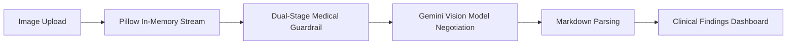

<div align="center">

# MediScan AI — Medical Image & Medicine Recognition System

**Multimodal clinical analysis system utilizing Google Gemini Vision to transcribe handwritten doctor prescriptions, identify dosages, and generate structured observations for diagnostic imagery.**


[⚙️ Installation](#️-installation) • [▶️ Usage](#️-usage) • [📁 Project Structure](#-project-structure)

</div>

## 🎯 Problem Statement
Medical documents such as handwritten doctor prescriptions, clinic slips, and diagnostic imaging (X-rays, MRIs, CT scans) are challenging to interpret rapidly and transcribe accurately. Manual data entry is slow, increases clerical workload, and creates risks of misreading complex pharmaceutical dosages or diagnostic details.

## 💡 Solution
MediScan AI delivers an intelligent, privacy-preserving multimodal web application that processes medical scans and prescriptions directly in memory (zero disk persistence). Utilizing Google Gemini Vision models with dynamic runtime model negotiation and a dual-stage medical guardrail, it extracts medication names, schedules, and clinical findings into clean, formatted reports.

## 🧠 Methodology

- **Ingestion:** Direct in-memory byte stream processing using `io.BytesIO` and Base64 data URIs without disk writes.
- **Guardrails:** Two-stage verification pipeline that filters out non-medical imagery (memes, landscapes, objects).
- **Model Negotiation:** Dynamic runtime discovery via `genai.list_models()` falling back across Gemini 2.5 Flash, 2.0 Flash, and 1.5 Pro to prevent deprecation failures.

## 🛠️ Tech Stack
- **Backend:** Python 3.10+, Flask 3.x, `google-generativeai`, `Pillow (PIL)`, `python-dotenv`, `python-markdown`
- **Frontend:** Responsive HTML5, modern CSS3 (Flexbox/Grid), Vanilla JavaScript (Drag-and-Drop, Clipboard API)

## 📊 Results
| Capability | Implementation Detail |
|------------|-----------------------|
| Processing Pipeline | In-memory stream (`io.BytesIO`), zero disk persistence |
| Image Verification | Dual-stage guardrail preventing irrelevant non-medical analysis |
| Model Resilience | Automated fallback negotiation across Gemini 2.5 / 2.0 / 1.5 |

## ⚙️ Installation
```bash
git clone https://github.com/amrit0012vr/Med-recognition.git
cd Med-recognition
python -m venv venv
# Windows:
venv\Scripts\activate
# macOS/Linux:
source venv/bin/activate
pip install -r requirements.txt
```

## ▶️ Usage
1. Configure your API key in `.env`:
```env
GOOGLE_API_KEY=your_gemini_api_key_here
GEMINI_MODEL=gemini-2.0-flash
PORT=5000
```
2. Launch the application:
```bash
python app.py
```
3. Open `http://127.0.0.1:5000` in your web browser.

## 📁 Project Structure
```text
Med-recognition/
├── .env.example
├── .gitignore
├── app.py
├── requirements.txt
├── run.bat
├── static/
│   └── style.css
└── templates/
    └── index.html
```

## 🔮 Future Improvements
- Add DICOM format parsing support for hospital-grade radiological scans.
- Integrate drug-drug interaction warning checks via open pharmacology databases.
- Implement multilingual output translation for regional health centers.

## 👤 Author
**Amrit Preetam Nayak** — [GitHub](https://github.com/amrit0012vr) • [LinkedIn](https://www.linkedin.com/in/amrit-preetam-nayak-667a7232b/)
